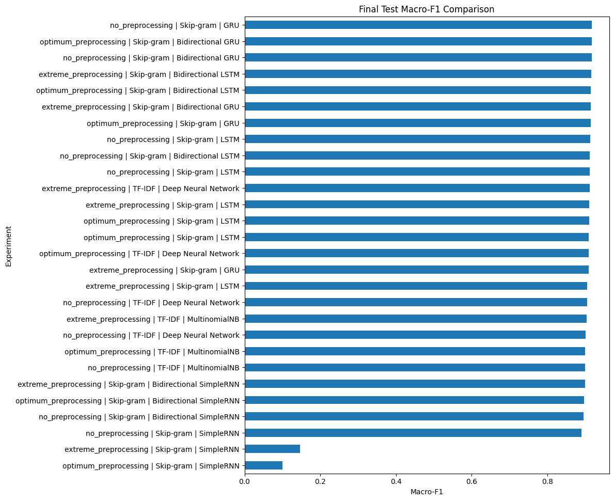
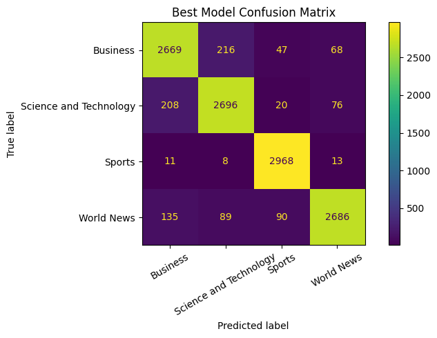

# News Topic Classification with Deep Learning

**An empirical NLP study comparing text-representation and sequence-modeling strategies for four-class news headline classification.**

[](https://www.python.org/)
[](https://www.tensorflow.org/)
[](https://scikit-learn.org/)
[](https://pytorch.org/)

This repository presents an end-to-end multiclass text-classification workflow for categorizing news headlines as **Business**, **Science & Technology**, **Sports**, or **World News**. It benchmarks sparse TF-IDF features against learned Skip-gram Word2Vec embeddings across classical machine learning, feedforward neural networks, and recurrent sequence architectures.

The central engineering question is deliberately practical: **when does preprocessing improve a headline classifier, and when does it remove useful signal?** To answer it, the project evaluates 24 independently tuned representation–model–preprocessing combinations using a held-out test set.

> **Best configuration:** Skip-gram Word2Vec + GRU on raw headlines achieved **91.83% test accuracy** and **0.9180 macro-F1**.

---

## Why This Repository Matters

| Capability | Evidence in this project |
|---|---|
| **Data quality awareness** | Detected and removed **28,833 duplicate** training records before splitting, reducing validation leakage risk. |
| **Experimental rigor** | Compared **24 configurations** across three preprocessing strategies, two representations, and eight model families. |
| **Appropriate evaluation** | Used stratified validation, a final held-out test set, per-class reports, confusion matrices, accuracy, and macro-F1. |
| **Reproducible workflow** | Fixed seeds, isolated train/validation/test use, explicit parameter grids, dependency manifest, and modular utilities. |
| **Deep learning fluency** | Built and tuned DNN, RNN, GRU, LSTM, BiRNN, BiGRU, and BiLSTM classifiers with early stopping and dropout. |

---

## Results at a Glance

| Rank | Model | Text representation | Preprocessing | Test accuracy | Test macro-F1 |
|---:|---|---|---|---:|---:|
| **1** | **GRU** | **Skip-gram Word2Vec** | **Raw text** | **91.83%** | **0.9180** |
| 2 | Bidirectional GRU | Skip-gram Word2Vec | Optimum | 91.80% | 0.9178 |
| 3 | Bidirectional GRU | Skip-gram Word2Vec | Raw text | 91.75% | 0.9172 |
| 4 | Bidirectional LSTM | Skip-gram Word2Vec | Extreme | 91.68% | 0.9164 |
| 5 | Deep Neural Network | TF-IDF | Extreme | 91.18% | 0.9116 |

<details>
<summary><strong>View all 24 evaluated configurations</strong></summary>

| Preprocessing | Representation | Model | Test accuracy | Test macro-F1 |
|---|---|---|---:|---:|
| Raw | TF-IDF | Multinomial Naive Bayes | 90.07% | 0.9001 |
| Extreme | TF-IDF | Multinomial Naive Bayes | 90.44% | 0.9039 |
| Optimum | TF-IDF | Multinomial Naive Bayes | 90.07% | 0.9001 |
| Raw | TF-IDF | Deep Neural Network | 90.50% | 0.9050 |
| Extreme | TF-IDF | Deep Neural Network | 91.18% | 0.9116 |
| Optimum | TF-IDF | Deep Neural Network | 91.01% | 0.9097 |
| Raw | Skip-gram | SimpleRNN | 89.08% | 0.8898 |
| Extreme | Skip-gram | SimpleRNN | 26.83% | 0.1470 |
| Optimum | Skip-gram | SimpleRNN | 25.00% | 0.1000 |
| **Raw** | **Skip-gram** | **GRU** | **91.83%** | **0.9180** |
| Extreme | Skip-gram | GRU | 90.96% | 0.9091 |
| Optimum | Skip-gram | GRU | 91.44% | 0.9143 |
| Raw | Skip-gram | LSTM | 91.43% | 0.9141 |
| Extreme | Skip-gram | LSTM | 91.06% | 0.9102 |
| Optimum | Skip-gram | LSTM | 91.05% | 0.9100 |
| Raw | Skip-gram | Bidirectional RNN | 89.60% | 0.8956 |
| Extreme | Skip-gram | Bidirectional RNN | 90.06% | 0.8996 |
| Optimum | Skip-gram | Bidirectional RNN | 89.70% | 0.8965 |
| Raw | Skip-gram | Bidirectional GRU | 91.75% | 0.9172 |
| Extreme | Skip-gram | Bidirectional GRU | 91.48% | 0.9144 |
| Optimum | Skip-gram | Bidirectional GRU | 91.80% | 0.9178 |
| Raw | Skip-gram | Bidirectional LSTM | 91.24% | 0.9119 |
| Extreme | Skip-gram | Bidirectional LSTM | 91.68% | 0.9164 |
| Optimum | Skip-gram | Bidirectional LSTM | 91.57% | 0.9151 |

</details>

---

## Visual Evidence

| Test Macro-F1 Across All Experiments | Top Model: GRU Confusion Matrix |
|---|---|
|  |  |

The strongest result was not simply selected by accuracy. Macro-F1 was treated as the primary selection metric because the deduplicated training data remain moderately class-imbalanced. The final GRU confusion matrix shows strong separation across all four categories.

---

## Technical Approach

### Dataset and leakage controls

The input consists of 88,829 training headlines and 12,000 test headlines spanning four news categories. Initial exploratory analysis found 28,833 exact duplicates in the training set. These records were removed **before** producing the stratified training/validation split, mitigating inflated validation scores caused by identical headlines appearing in both partitions. The supplied test data were not used for tuning and were reserved for final evaluation.

### Preprocessing comparison

Rather than assuming that aggressive cleaning helps, three controlled text variants were evaluated:

| Strategy | Transformations | Intent |
|---|---|---|
| **Raw** | Input text is preserved | Establish an unfiltered baseline and assess model robustness to source artifacts. |
| **Extreme** | HTML removal, lowercasing, URL/punctuation/number removal, stopword removal, lemmatization, and stemming | Measure the effect of aggressive normalization. |
| **Optimum** | Removes HTML, repeated wrapper text, URLs, and noisy symbols while retaining numbers and apostrophes | Apply targeted cleanup without discarding topical tokens and named-entity cues. |

### Representations and models

The workflow compares the following model families:

| Representation | Models | Validation approach |
|---|---|---|
| **TF-IDF** | Multinomial Naive Bayes; Dense Neural Network | Parameter grids over feature limits, n-gram ranges, smoothing, architecture, dropout, and learning rate. |
| **Skip-gram Word2Vec** | SimpleRNN, GRU, LSTM, BiRNN, BiGRU, BiLSTM | Word2Vec trained on the training partition only; learned embeddings are fine-tuned by sequence models. |

The recurrent models use trainable 100-dimensional Skip-gram embeddings, 45-token padded sequences, dropout regularization, Adam optimization, and early stopping. The DNN uses a four-layer dense architecture, while sequence classifiers add a compact dense classification head after the recurrent layer.

---

## Key Findings

**Gated recurrent networks performed best.** GRU and bidirectional GRU variants consistently led the benchmark, with the top GRU configuration achieving a 0.9180 macro-F1 score.

**Raw headlines outperformed more aggressive cleaning in the best configuration.** This is a meaningful result rather than an omission: Word2Vec embeddings and gated recurrence retained or learned useful structure even in the presence of lightweight source artifacts. Excessive preprocessing can remove named entities, morphology, numbers, and surface cues that differentiate news topics.

**A stronger architecture is not always the better deployment choice.** The best BiGRU was only 0.0002 macro-F1 behind the top GRU. For short headlines, the standard GRU provides nearly equivalent predictive quality with a simpler directional architecture and lower computational overhead.

**Vanilla RNNs were sensitive to preprocessing.** Their weak performance under extreme and optimum cleaning illustrates the limitations of non-gated recurrence when sequences have been heavily transformed, reinforcing the value of GRU/LSTM gates for stable sequence modeling.

---

## Repository Layout

```text
news-topic-classification-nlp/
├── notebooks/
│   └── news_topic_classifier_experiments.ipynb  # Reproducible end-to-end benchmark
├── src/
│   ├── preprocessing.py                         # Raw, extreme, and targeted cleaning pipelines
│   ├── models.py                                # Reusable TensorFlow/Keras model factories
│   └── evaluation.py                            # Evaluation, result logging, and visualizations
├── reports/
│   └── experimental_report.pdf                  # Full technical report and experimental discussion
├── assets/                                      # Generated evaluation figures embedded in this README
├── requirements.txt
└── .gitignore
```

---

## Getting Started

### 1. Create an environment and install dependencies

```bash
git clone https://github.com/<your-username>/news-topic-classification-nlp.git
cd news-topic-classification-nlp
python -m venv .venv
```

Activate the environment:

```bash
# macOS / Linux
source .venv/bin/activate

# Windows PowerShell
.venv\Scripts\Activate.ps1
```

Then install dependencies:

```bash
pip install -r requirements.txt
```

### 2. Add the dataset

The dataset is intentionally excluded from version control. Place the following source files in a local `data/` directory:

```text
data/
├── Training_data_9.csv
└── Test_data.csv
```

The expected fields are `News Headline` and `News Topic`.

### 3. Run the benchmark

Launch Jupyter from the repository root:

```bash
jupyter notebook notebooks/news_topic_classifier_experiments.ipynb
```

Update `TRAIN_PATH` and `TEST_PATH` in the configuration cell if your data are stored elsewhere. The notebook is self-contained and will reproduce the EDA, preprocessing variants, tuning workflow, evaluation tables, and model comparison visualizations.

> **Hardware note:** Full recurrent-model experiments are compute-intensive. A smaller sample or reduced epoch count is recommended for a quick pipeline check; GPU acceleration is recommended for the complete benchmark.

---

## Dependencies

The project uses Python with TensorFlow/Keras for the neural classifiers and scikit-learn for classical text models and metrics. Gensim provides Word2Vec, NLTK provides language utilities, and Pandas/Matplotlib/WordCloud support exploration and reporting. See [`requirements.txt`](requirements.txt) for exact package requirements.

---

## Technical Report

The complete methodology, dataset analysis, model results, and limitations are documented in [`reports/experimental_report.pdf`](reports/experimental_report.pdf).

Potential extensions include Transformer-based classifiers such as BERT, pretrained embeddings such as FastText or GloVe, probability calibration, and systematic error analysis by topic and headline length.

---

## Reproducibility Notes

- Fixed random seed: **42**.
- Deduplication happens before the training/validation split.
- Validation data select hyperparameters; the test set is used only once for final evaluation.
- Macro-F1 complements accuracy and gives each topic equal weight.
- The external dataset is not redistributed in this repository.

---

## Author

**Fayez Ahmad Protik**

If this project was helpful or you would like to discuss the modeling decisions, feel free to connect through my GitHub profile.
